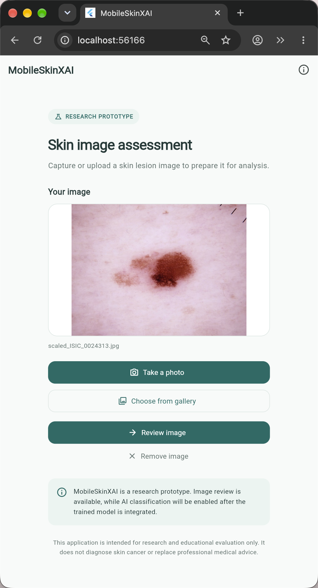
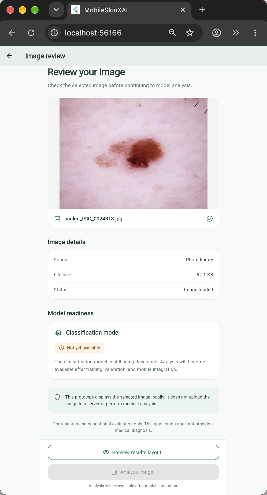
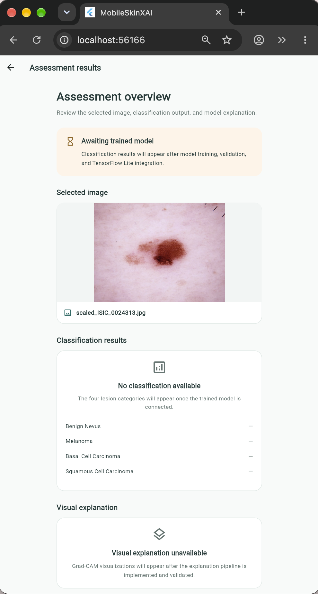

# MobileSkinXAI

### Explainable and Lightweight Deep Learning for Mobile Skin Lesion Screening

MobileSkinXAI is a research-driven Flutter application being developed as part of an undergraduate thesis in Computer Science and Engineering at Daffodil International University, Bangladesh.

The project explores how lightweight deep learning and Explainable Artificial Intelligence (XAI) can support accessible, mobile-based skin lesion screening.

The application is designed to classify four skin lesion categories using a trained deep learning model, with future integration of Grad-CAM explanations to help users understand which image regions influence model predictions.

**Current status:** Flutter interface prototype completed. Model training, validation, and on-device inference integration are in progress or planned.

> **Medical disclaimer:** MobileSkinXAI is an experimental research prototype, not a clinically validated medical device. It does not provide a medical diagnosis or replace professional dermatological assessment.

---

## Application Preview

The current prototype includes image selection, image review, and a results interface prepared for future model integration.

<p align="center">
  
  &nbsp;
  
  &nbsp;
  
</p>

<p align="center">
  <em>Early development screenshots of the MobileSkinXAI Flutter application.</em>
</p>

The screenshots illustrate the interface and navigation workflow. Classification results and visual explanations are not yet generated by a trained model.

---

## Research Objectives

The primary objectives of MobileSkinXAI are:

1. Develop a lightweight deep learning framework for skin lesion classification.
2. Investigate classification across four categories:
   - Benign Nevus
   - Melanoma
   - Basal Cell Carcinoma (BCC)
   - Squamous Cell Carcinoma (SCC)
3. Train and evaluate the classification model using suitable images from ISIC 2019.
4. Investigate cross-domain generalization using the PAD-UFES-20 clinical image dataset, subject to compatible class mapping.
5. Incorporate Grad-CAM to visualize image regions influencing predictions.
6. Deploy an optimized TensorFlow Lite model in a Flutter mobile application.
7. Evaluate classification performance, model size, inference latency, and mobile resource requirements.

---

## Current Features

### Implemented

- Responsive Flutter interface
- Image selection from the gallery
- Camera image acquisition workflow
- Image preview and removal
- Image review screen
- Display of image source, filename, and file size
- Results interface with four predefined lesion categories
- Model availability and readiness indicators
- Placeholder for future Grad-CAM visualization
- Navigation between home, review, and results screens
- Research and medical limitation notices

### Planned

- Trained four-class skin lesion classification model
- TensorFlow Lite on-device inference
- Image preprocessing consistent with model training
- Class probability visualization using real model outputs
- Grad-CAM explanation generation and visualization
- Input image suitability and quality checks
- Model inference time measurement
- Android and iOS device performance evaluation
- Further accessibility and usability testing

The current results screen is a layout preview. It does not generate predictions or artificial confidence scores.

---

## Technology Stack

| Component | Technology |
|-----------|------------|
| Mobile application | Flutter |
| Programming language | Dart |
| Deep learning | TensorFlow / Keras (planned) |
| Mobile inference | TensorFlow Lite (planned) |
| Explainability | Grad-CAM (planned) |
| Primary research dataset | ISIC 2019 |
| External evaluation dataset | PAD-UFES-20 |
| Development environment | VS Code |
| Version control | Git and GitHub |

---

## Application Workflow

```text
Launch Application
        |
        v
Select or Capture Image
        |
        v
Review Selected Image
        |
        v
Preview Results Layout
        |
        v
Await Trained Model
```

The future inference workflow will extend this process:

```text
Input Image
     |
     v
Image Preprocessing
     |
     v
TensorFlow Lite Model
     |
     +----> Four-Class Classification
     |
     +----> Model Score Visualization
     |
     +----> Grad-CAM Explanation
     |
     v
Assessment Results
```

The second workflow represents the intended architecture and has not yet been fully implemented.

---

## Project Structure

```text
app/flutter/
|
|-- android/
|-- ios/
|-- assets/
|   |-- models/
|
|-- lib/
|   |-- main.dart
|   |
|   |-- screens/
|   |   |-- home_screen.dart
|   |   |-- analysis_screen.dart
|   |   |-- results_screen.dart
|   |
|   |-- models/
|   |-- services/
|
|-- screenshots/
|   |-- home_screen.png
|   |-- image_review.png
|   |-- results_screen.png
|
|-- test/
|-- pubspec.yaml
|-- README.md
```

Some directories contain components reserved for future model integration.

---

## Getting Started

### Prerequisites

- Flutter SDK
- Dart SDK (included with Flutter)
- Visual Studio Code or Android Studio
- Chrome for web-based interface testing
- Android emulator or physical device for mobile testing

### 1. Clone the repository

```bash
git clone https://github.com/rinviriti/MobileSkinXAI.git
cd MobileSkinXAI/app/flutter
```

### 2. Install dependencies

```bash
flutter pub get
```

### 3. Check the development environment

```bash
flutter doctor
```

### 4. Run the application

For web-based interface testing:

```bash
flutter run -d chrome
```

For a connected mobile device:

```bash
flutter devices
flutter run
```

### 5. Run static analysis

```bash
flutter analyze
```

**Note:** The Flutter interface can be tested without a trained model. TensorFlow Lite inference and Grad-CAM generation are not yet available.

---

## Research Datasets

### ISIC 2019

The ISIC 2019 dataset is intended for model development and internal evaluation.

Dataset: https://challenge.isic-archive.com/data/

### PAD-UFES-20

PAD-UFES-20 contains smartphone-acquired clinical skin lesion images and is intended for investigating cross-domain generalization.

Dataset: https://data.mendeley.com/datasets/zr7vgbcyr2/1

The datasets differ in image acquisition methods and diagnostic label structures. Class mapping, sample eligibility, and evaluation protocols must be established before reporting four-class external validation results.

Dataset access, licensing, attribution, and permitted use should be checked against the respective providers' terms.

---

## Research Evaluation Plan

The proposed framework will be evaluated using:

**Classification performance**
- Accuracy and balanced accuracy
- Per-class precision, recall, and F1-score
- Confusion matrix
- ROC-AUC, where applicable

**Cross-domain evaluation**
- Performance on eligible PAD-UFES-20 samples
- Domain-shift analysis
- Per-class generalization performance

**Explainability**
- Grad-CAM visualization
- Qualitative explanation analysis
- Explanation reliability assessment

**Mobile performance**
- TensorFlow Lite model size
- Inference latency
- Memory consumption
- Device-level testing

All experimental findings will be reported after model development and evaluation.

---

## Development Status

| Development Stage | Status |
|-------------------|--------|
| Flutter project setup | Completed |
| Home screen | Completed |
| Gallery image selection | Tested |
| Image review screen | Completed |
| Results interface | Completed |
| Model training | Pending |
| External dataset evaluation | Pending |
| Grad-CAM integration | Pending |
| TensorFlow Lite inference | Pending |
| Mobile benchmarking | Pending |

---

## Author

**Rinvi Jaman Riti**  
Department of Computer Science and Engineering  
Daffodil International University, Bangladesh

GitHub: [@rinviriti](https://github.com/rinviriti)

---

## Project Status and Disclaimer

MobileSkinXAI is under active research and development.

The application currently supports image selection and interface-level review. It does not perform clinical screening, diagnosis, or treatment recommendations.

Future model outputs must be interpreted within the limitations of the training datasets, validation protocol, and intended research setting.

© 2026 Rinvi Jaman Riti.
